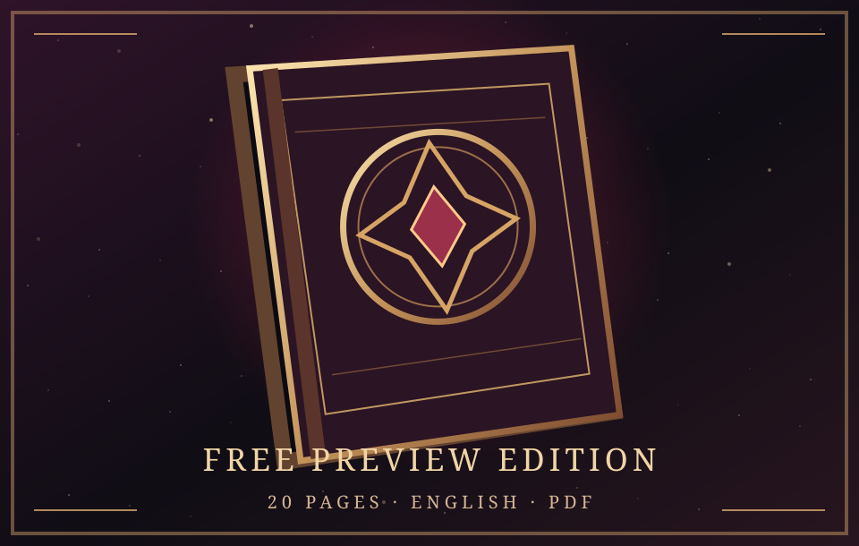

# Free Preview Edition — English

**Published:** 16 November 2026

**[View published release](https://github.com/Brinkhagen/the-black-grimoire/releases/tag/preview-en-001)** · **[Download the PDF](https://github.com/Brinkhagen/the-black-grimoire/releases/download/preview-en-001/THE.BLACK.GRIMOIRE.A.Dark.Fantasy.5.5e.Sourcebook.pdf)**

> Every village buries a secret. Some secrets learn to breathe.

The Black Grimoire free **20-page English draft preview** introduces a dark fantasy sourcebook intended for 5E-compatible tabletop play.

### Inside the preview

- **Three creatures:** The Ashen Witch, The Grave Maw Wolf, The Hollow Lantern Saint.
- **Four forbidden relics:** magical items with narrative costs.
- **One mini-adventure:** The Village Without Shadows.
- **Game Master reference:** additional material supporting the sample.

### Release details

- **Tag:** `preview-en-001`
- **Actual release asset:** `THE.BLACK.GRIMOIRE.A.Dark.Fantasy.5.5e.Sourcebook.pdf`
- **Language:** English · **Price:** Free · **PDF length in the prepared preview:** 20 pages.
- **No sign-in or pledge required.**

This is **not the finished sourcebook**. The draft rules, creatures, illustrations and adventure may change and have not undergone formal playtesting. Illustrations and portions of text were created with AI assistance. The PDF includes SRD 5.2.1 attribution under the CC BY 4.0 license. This is an independent, unofficial sourcebook project.

**File verification note:** The uploaded file name differs from our original planned filename. Visitors should use the exact published asset link above.

[Free Original Soundtrack 001](https://github.com/Brinkhagen/the-black-grimoire/releases/tag/soundtrack-001) · [Kickstarter](https://www.kickstarter.com/projects/anilsari/the-black-grimoire-a-dark-fantasy-55e-sourcebook)
