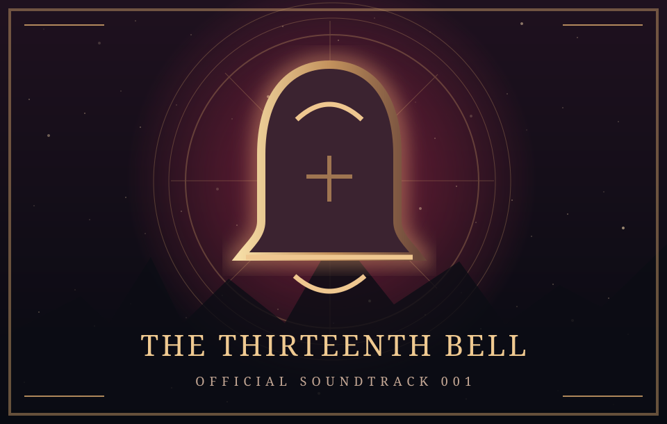

# The Thirteenth Bell — Official Soundtrack 001

**Published:** 16 November 2026

**[View published release](https://github.com/Brinkhagen/the-black-grimoire/releases/tag/soundtrack-001)** · **[Download the MP3](https://github.com/Brinkhagen/the-black-grimoire/releases/download/soundtrack-001/The.Black.Grimoire.The.Thirteenth.Bell.Official.Original.Soundtrack.001.mp3)**

> Before the first page is turned, the thirteenth bell must ring.

A cinematic prologue to The Black Grimoire, featuring dark orchestral music, an ancient speaking voice and a gothic choir.

- **Tag:** `soundtrack-001`
- **Actual release asset:** `The.Black.Grimoire.The.Thirteenth.Bell.Official.Original.Soundtrack.001.mp3`
- **Format:** MP3 · English · Free
- **No sign-in or pledge required**
- **Production disclosure:** Made with AI-assisted music generation using Suno; project concept, lyrics and creative selection created for The Black Grimoire.

**Rights note:** The publisher should retain evidence of the subscription and terms applicable at the time the track was generated. Availability as a free download does not automatically grant commercial rights or permissions for third-party reuse.

[Free English Preview PDF](https://github.com/Brinkhagen/the-black-grimoire/releases/tag/preview-en-001) · [Kickstarter](https://www.kickstarter.com/projects/anilsari/the-black-grimoire-a-dark-fantasy-55e-sourcebook)
